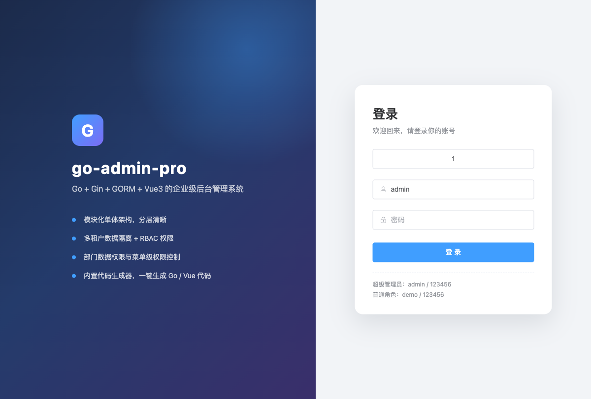
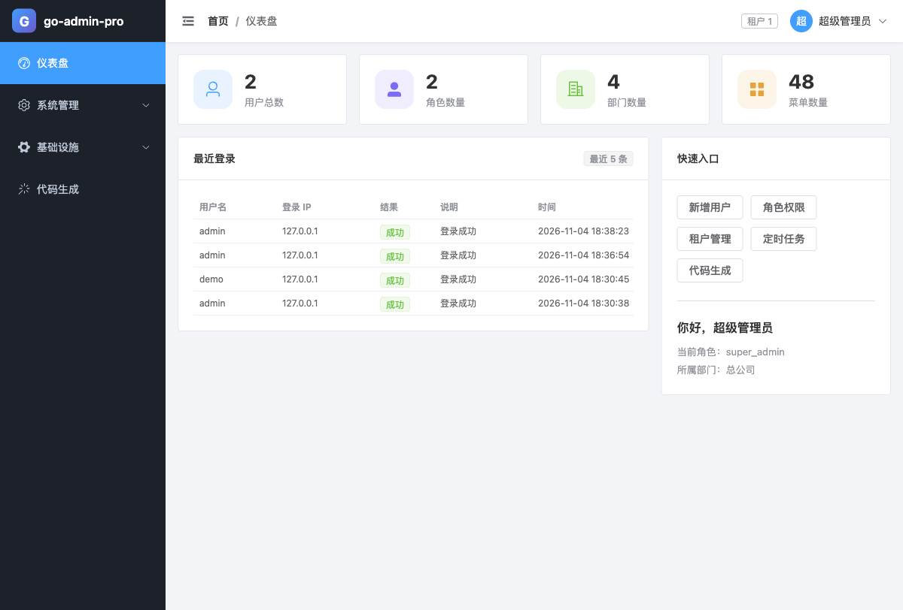
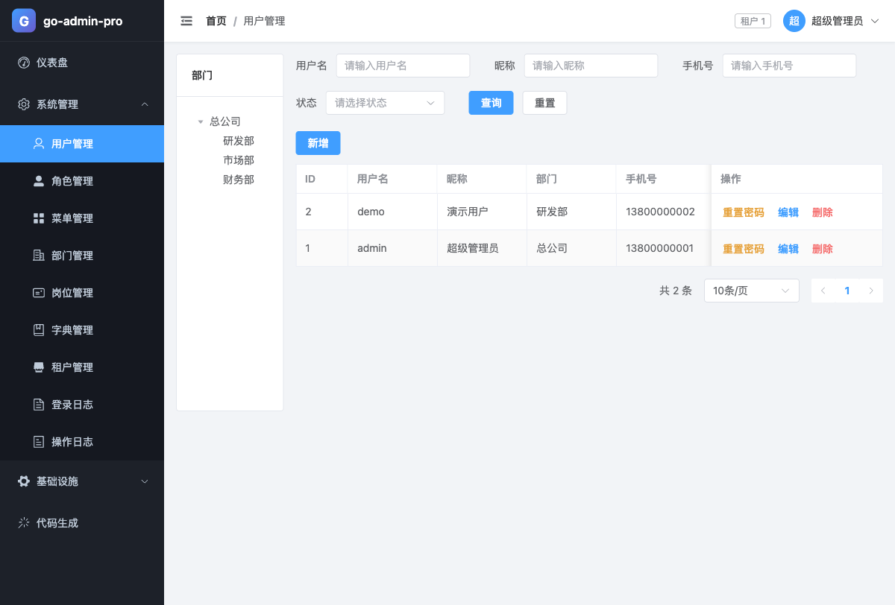

# go-admin-pro

[](https://github.com/lautung/go-admin-pro/actions/workflows/ci.yml)
[](https://go.dev/)
[](https://vuejs.org/)
[](LICENSE)

基于 **Go + Gin + GORM + MySQL + Vue3** 的企业级后台管理系统。

设计思路对标 [芋道源码 ruoyi-vue-pro](https://github.com/YunaiV/ruoyi-vue-pro)：模块化单体分层、RBAC + 数据权限、多租户、代码生成器、基础设施模块，用 Go 重新实现。目标不是逐行移植，而是把芋道里最有价值的那套「后台框架骨架」用 Go 生态落地成可运行、可扩展的工程。

## 界面预览

| 登录 | 仪表盘 |
| --- | --- |
|  |  |



## 功能特性

- **模块化单体**：`framework` 基础能力 + `system` / `infra` / `codegen` 业务模块，依赖单向、边界清晰。
- **认证与 RBAC**：JWT 登录、bcrypt 密码、角色绑定菜单、接口级权限码校验、超级管理员自动放行。
- **多租户**：GORM 插件自动追加 `tenant_id` 条件、插入自动回填；新建租户自动初始化部门 / 超级管理员角色 / `admin` 账号。
- **数据权限**：角色维度支持「全部 / 本部门及以下 / 本部门 / 仅本人」，用户列表已接入。
- **系统管理**：用户、角色、菜单（目录/菜单/按钮三级）、部门树、岗位、字典、租户、登录日志、操作日志。
- **基础设施**：本地文件存储、参数配置、Cron 定时任务（6 段表达式，支持立即执行、重试、执行日志）。
- **代码生成器**：读取 `information_schema`，一键生成 Go 的 model / dto / service / api 与 Vue3 增删改查页面，ZIP 下载。
- **前端动态路由**：菜单由后端下发，前端按组件路径动态注册，按钮权限通过 `v-if` 控制。
- **开箱即用**：`make migrate-up` 按版本建表，启动时校验迁移版本并写入种子数据（菜单、角色、管理员、字典、演示任务）。

## 相关文档

- 术语表：[GLOSSARY.md](GLOSSARY.md)
- 架构决策：[docs/adr/](docs/adr/)
- CRM 详细规格：[docs/crm-mvp-spec.md](docs/crm-mvp-spec.md)

## 技术栈

| 层次 | 选型 |
| --- | --- |
| 语言 | Go 1.26+ |
| Web 框架 | Gin |
| ORM | GORM + MySQL 8 |
| 迁移 | goose（版本化 SQL，可回滚） |
| 认证 | JWT（golang-jwt/jwt/v5）+ bcrypt |
| 配置 | Viper（YAML + 环境变量覆盖） |
| 定时任务 | robfig/cron/v3 |
| 验证码 | base64Captcha（默认关闭，可在配置中开启） |
| 前端 | Vue 3 + TypeScript + Vite + Element Plus + Pinia + Vue Router |
| 包管理 | pnpm 11 |

## 架构

```text
HTTP 请求
  → CORS / Recovery / AccessLog
  → JWT Auth（解析 token，写入 tenant / principal 上下文）
  → OperateLog（记录写操作）
  → RequirePermission（校验权限码）
  → Handler → Service → Repository → GORM（多租户插件）→ MySQL
```

```text
go-admin-pro
├── cmd/server/                 # 启动入口
├── cmd/migrate/                # 迁移命令（up / down / status / create）
├── migrations/                 # goose 版本化 SQL，内嵌进二进制
├── configs/config.yaml         # 配置文件
├── internal/
│   ├── app/                    # 依赖装配
│   ├── config/                 # 配置加载
│   ├── router/                 # 路由、静态资源、SPA 回退
│   ├── seed/                   # 初始化数据（依赖已执行的迁移）
│   ├── module/
│   │   ├── system/             # 认证、用户、角色、菜单、部门、岗位、字典、租户、日志
│   │   ├── infra/              # 文件、参数配置、定时任务
│   │   └── codegen/            # 代码生成器
│   └── pkg/                    # 框架能力
│       ├── database/           # GORM 连接、迁移校验 + 多租户插件
│       ├── tenant/             # 租户上下文与 Skip
│       ├── jwt/ authn/         # 令牌与登录主体
│       ├── middleware/         # CORS、日志、Recovery
│       ├── excel/              # Excel 导入导出与模板
│       ├── money/              # 金额值类型（int64 分，decimal(12,2)）
│       ├── response/ xerr/     # 统一响应与业务错误
│       └── web/ utils/         # 分页、通用工具
├── web/                        # Vue3 前端
│   └── src/{api,components,layout,router,stores,views}
├── docs/images/
├── Dockerfile
├── docker-compose.yml
└── Makefile
```

## 快速开始

### 环境要求

- Go 1.26+
- Node.js 22+、pnpm 11+
- MySQL 8（或 Docker）

### 1. 启动 MySQL

```bash
docker compose up -d mysql
```

默认创建数据库 `go_admin_pro`，root 密码 `123456`。也可以使用已有 MySQL，修改 `configs/config.yaml` 的 `database.dsn`。

### 2. 执行迁移并启动后端

```bash
make migrate-up            # 按版本执行 migrations/ 下的 SQL，可重复执行
go run ./cmd/server -c configs/config.yaml
```

服务启动时只校验迁移版本，不会自动建表：数据库未迁移、落后或超前都会直接报错退出。首次启动会写入种子数据（可用 `GAP_SEED=false` 关闭）。

服务地址：`http://127.0.0.1:8080`，健康检查：`GET /healthz`。

关键配置支持环境变量覆盖：

```bash
export GAP_DATABASE_DSN='root:123456@tcp(127.0.0.1:3306)/go_admin_pro?charset=utf8mb4&parseTime=True&loc=Local'
export GAP_JWT_SECRET='please-change-me'
export GAP_APP_PORT=8080
export GAP_SEED=false   # 生产环境可关闭种子写入
```

### 3. 启动前端（开发模式）

```bash
cd web
pnpm install
pnpm dev
```

访问 `http://localhost:5173`，Vite 会把 `/admin-api` 与 `/files` 代理到 `http://127.0.0.1:8080`。

### 4. 生产构建

```bash
pnpm --dir web build          # 产物：web/dist
go build -trimpath -o bin/server ./cmd/server
go build -trimpath -o bin/migrate ./cmd/migrate
./bin/migrate -c configs/config.yaml up   # 首次部署 / 升级前执行
./bin/server -c configs/config.yaml
```

Go 服务会自动托管 `web/dist`，单进程即可提供前端与 API（`app.web-root` 可配置）。

### 默认账号

| 租户 | 账号 | 密码 | 说明 |
| --- | --- | --- | --- |
| 1 | `admin` | `123456` | 超级管理员，全部权限 |
| 1 | `demo` | `123456` | 普通角色，仅本人数据权限 |
| 新建租户 | `admin` | `123456` | 创建租户时自动初始化 |

> 生产环境请务必修改默认密码与 `jwt.secret`。

## 核心设计

### 版本化迁移

表结构由 `migrations/` 下的 goose SQL 管理，迁移文件会内嵌进二进制：

- `make migrate-up`：按版本执行未应用的迁移，可重复执行。
- `make migrate-down` / `make migrate-reset`：回滚一个 / 全部版本。**回滚会执行 Down 段的 DROP，请先备份；当前基线回滚等于删掉全部 17 张表。**
- `make migrate-status`：查看每个版本的应用状态。
- `make migrate-stamp version=1`：把结构已存在但没有迁移记录的库标记为指定版本，不执行 DDL。
- `make migrate-create name=add_xxx`：生成下一个版本的 SQL 模板。

迁移默认超时 30 分钟，可用 `go run ./cmd/migrate -timeout 0 up` 关闭超时（数据迁移或 backfill 建议显式放宽）。

应用启动时只校验迁移版本，不建表也不执行迁移；数据库未迁移、落后或超前都会报错退出。已发布的迁移不要修改，表结构变更一律新增文件。

旧版 AutoMigrate 建的库没有 goose 版本记录：先备份，人工核对 17 张表结构与基线一致后执行 `make migrate-stamp version=1`；不一致或开发环境无数据时，删库后重新 `make migrate-up` 更干净。

MySQL 的 DDL 不在事务里：基线在一个文件中建 17 张表，中途失败会留下半套表，需要手工清理后重跑。后续迁移保持单个 DDL，或写成可重入语句。

### 多租户隔离

租户来自 JWT 的 `tenantId`，由 Auth 中间件写入 `context.Context`：

```go
ctx = tenant.WithTenantID(ctx, claims.TenantID)
```

`tenant.TenantPlugin` 注册 GORM 回调：

- **Query / Update / Delete**：对注册过的表自动追加 `tenant_id = ?`，业务代码无需重复拼装。
- **Create**：自动回填 `tenant_id`，避免遗漏。
- **系统级操作**：`tenant.Skip(db)` 可跳过过滤（如统计某租户用户数）。
- **表清单**：`internal/pkg/database/tenant_tables.go`，新增业务表时按需登记。

创建租户时会自动生成：默认部门「总公司」、内置角色 `super_admin`、管理员 `admin/123456`。

### 数据权限

权限范围配置在角色上：

| 值 | 含义 |
| --- | --- |
| 1 | 全部数据 |
| 2 | 本部门及以下 |
| 3 | 本部门 |
| 4 | 仅本人 |

`service.UserCenter` 会汇总用户所有角色，取最大范围并计算可见部门集合；用户列表查询据此追加条件。其他业务模块可复用同一方法扩展数据权限。

### 权限模型

- 菜单分三类：`1 目录`、`2 菜单`、`3 按钮`。
- 接口权限码形如 `system:user:create`，由 `RequirePermission` 中间件校验。
- `super_admin` 角色直接获得 `*`，绕过权限码校验。
- 前端登录后调用 `/system/auth/user-info` 获取菜单树与权限码，动态注册路由并控制按钮显示。

### 代码生成器

1. 在数据库中创建业务表（`system_` / `infra_` 前缀的表会被排除）。
2. 打开「代码生成」页面，选择表 → 自动带出字段 → 填写模块名、业务名、类名。
3. 生成并下载 ZIP，包含：

```text
go/internal/module/{module}/model/{business}.go
go/internal/module/{module}/dto/{business}.go
go/internal/module/{module}/service/{business}.go
go/internal/module/{module}/api/{business}.go
web/src/api/{module}/{business}.ts
web/src/views/{module}/{business}/index.vue
README.md
```

4. 按 ZIP 内 README 把代码放入工程、注册路由，并在「菜单管理」中新增对应权限码。

生成器会校验表名、模块名、业务名、类名，避免路径穿越；生成的 Go 代码通过 `go/format` 格式化，可直接编译。项目内置的 `biz_product` 演示表可通过以下 SQL 创建：

```sql
CREATE TABLE biz_product (
  id bigint NOT NULL AUTO_INCREMENT,
  name varchar(100) NOT NULL COMMENT '商品名称',
  code varchar(50) NOT NULL COMMENT '商品编码',
  price decimal(10,2) DEFAULT NULL COMMENT '价格',
  stock int DEFAULT 0 COMMENT '库存',
  status tinyint DEFAULT 0 COMMENT '状态',
  description text COMMENT '描述',
  created_at datetime DEFAULT NULL,
  updated_at datetime DEFAULT NULL,
  deleted_at datetime DEFAULT NULL,
  PRIMARY KEY (id)
) ENGINE=InnoDB DEFAULT CHARSET=utf8mb4 COMMENT='商品表';
```

### 定时任务

- 表达式为 **6 段（含秒）**，例如 `0 */5 * * * *` 表示每 5 分钟。
- 内置处理器：`demoJob`、`cleanLogs`（参数为保留天数，默认 30）。
- 新增处理器：在 `internal/app/app.go` 中调用 `scheduler.Register("name", fn)`。
- 支持开启 / 暂停、立即执行、失败重试与执行日志。

## API 约定

统一响应：

```json
{ "code": 0, "data": {}, "msg": "" }
```

- `code = 0` 成功；非 0 为业务错误；HTTP 状态码同时表达语义（400/401/403/404/409/500）。
- 分页参数：`pageNo`、`pageSize`；分页响应：`{ "list": [], "total": 0 }`。
- 认证：`Authorization: Bearer <accessToken>`。

示例：

```bash
TOKEN=$(curl -s -X POST http://127.0.0.1:8080/admin-api/system/auth/login \
  -H 'Content-Type: application/json' \
  -d '{"username":"admin","password":"123456","tenantId":1}' | jq -r .data.accessToken)

curl -s "http://127.0.0.1:8080/admin-api/system/user/page?pageNo=1&pageSize=10" \
  -H "Authorization: Bearer $TOKEN"
```

主要接口前缀：

| 模块 | 前缀 |
| --- | --- |
| 认证 | `/admin-api/system/auth/*` |
| 用户 / 角色 / 菜单 / 部门 / 岗位 / 字典 / 租户 / 日志 | `/admin-api/system/*` |
| 文件 / 参数 / 定时任务 | `/admin-api/infra/*` |
| 代码生成 | `/admin-api/infra/codegen/*` |

## 配置说明

| 配置项 | 说明 |
| --- | --- |
| `app.port` | HTTP 端口 |
| `app.api-prefix` | API 前缀，默认 `/admin-api` |
| `app.web-root` | 前端产物目录，默认 `./web/dist` |
| `database.dsn` | MySQL DSN |
| `database.seed` | 启动时写入种子数据 |
| `jwt.secret` / `jwt.expire` | JWT 密钥与有效期 |
| `security.captcha.enabled` | 是否启用图形验证码 |
| `security.login.max-fail` / `lock-duration` | 登录失败锁定策略 |
| `storage.local.base-path` | 本地文件存储根目录 |
| `storage.local.public-prefix` | 文件访问前缀，默认 `/files` |
| `tenant.enabled` | 是否启用多租户插件 |
| `logger.level` / `format` | 日志级别与格式（text / json） |

## 部署

```bash
# 1. 构建前端
pnpm --dir web install --frozen-lockfile
pnpm --dir web build

# 2. 构建后端（server + migrate）
go build -trimpath -ldflags="-s -w" -o bin/server ./cmd/server
go build -trimpath -ldflags="-s -w" -o bin/migrate ./cmd/migrate

# 3. 执行数据库迁移（可重复执行；回滚用 down / reset）
GAP_DATABASE_DSN='...' ./bin/migrate -c configs/config.yaml up

# 4. 运行
GAP_DATABASE_DSN='...' GAP_JWT_SECRET='...' ./bin/server -c configs/config.yaml
```

使用 Docker：

```bash
docker compose up -d --build
```

compose 会先运行一次性的 `migrate` 服务，迁移成功后 `app` 才启动。镜像内已包含前端产物，访问 `http://127.0.0.1:8080`。

## 开发命令

```bash
make help         # 查看命令
make run          # 启动后端
make migrate-up    # 执行全部待执行迁移
make migrate-down  # 回滚一个迁移版本
make migrate-reset # 回滚全部迁移版本
make migrate-status # 查看迁移状态
make migrate-stamp version=1 # 已有库标记基线版本
make migrate-create name=add_xxx # 新建迁移文件
make test         # 运行测试
make test-integration # 运行集成测试（构建标签 integration）
make check        # fmt-check + build + vet + test-race
make vet          # 静态检查
make fmt          # gofmt
make web-dev      # 启动前端开发服务器
make web-build    # 构建前端
make build        # 构建后端二进制
make docker-up    # 启动 MySQL
make docker-down  # 停止容器
```

## 已知边界

这是一套可运行的框架骨架，而非完整商业产品，当前刻意保持以下边界：

- 登录态为无状态 JWT，未实现 refresh token / 服务端吊销列表。
- 文件存储仅实现本地磁盘，OSS / S3 可通过扩展 `infra` 模块接入。
- 字典、菜单权限等使用进程内缓存（权限码 1 分钟 TTL），多实例部署时需替换为 Redis 或统一失效。
- 未内置 Swagger，接口约定见上文与各 handler。
- 工作流、消息中心、支付、商城等芋道业务模块不在本次范围内，可按同样分层继续扩展。

## 后续计划

- [ ] Redis 缓存与登录态管理
- [ ] Excel 导入导出
- [ ] 对象存储（OSS / S3 / MinIO）
- [ ] 代码生成器支持树形表与主子表
- [ ] OpenAPI 文档（swaggo）
- [ ] 数据权限扩展到更多业务模块

## 贡献

欢迎提交 Issue / PR。提交前请确保：

```bash
go build ./... && go vet ./... && go test ./...
pnpm --dir web build
```

## License

[MIT](LICENSE)
